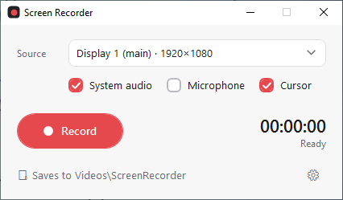
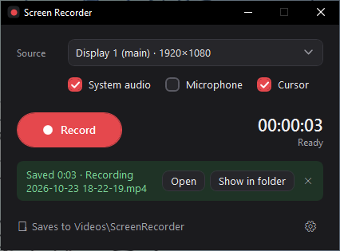

# Screen Recorder

A minimal screen recorder for Windows. Pick what to record, press **Record**, get an MP4.

<p>
  
  
</p>

## Features

- Record a **full display**, a single **window**, or a dragged **region**.
- **MP4** output (H.264 video, AAC audio) at 30 or 60 fps, three quality presets. Bitrate scales with the captured size and frame rate (Medium ≈ 7.5 Mbps at 1080p30), so small text stays readable.
- **System audio** and **microphone**, each optional; mouse **cursor** optional.
- **Pause / resume** without gaps in the file.
- **3-second countdown** (can be turned off). The countdown never appears in the video.
- The window **hides to the notification area** while recording, so it is never captured.
- **Global shortcuts** that work from any app:

  | Action | Default |
  |---|---|
  | Start / stop | `Ctrl+Shift+R` |
  | Pause / resume | `Ctrl+Shift+P` |

- After each recording: **Open** or **Show in folder** straight from the window.
- Follows the Windows **light / dark** app theme. Per-monitor DPI aware.
- Settings persist in `%AppData%\ScreenRecorder\settings.json`; the running log is in `%AppData%\ScreenRecorder\logs`.

## Error reports

Every failure or crash writes one detailed text file next to the app:

```
<install folder>\logs\<yyyy-MM-dd>\<yyyy-MM-dd_HH-mm-ss-fff>_<Problem>.txt
e.g.  logs\2026-10-26\2026-10-26_10-02-15-020_FileNotFoundException.txt
```

`<Problem>` is the type of the exception that started the failure. Each file contains:

1. A summary: time, severity, component, what was being done, and the problem.
2. **Main stack**: the stack trace of the exception where the problem started.
3. The full exception chain, with HResult, source, target site and data for each.
4. Context, such as the recording options or file paths involved.
5. The environment: app version, install folder, OS, .NET runtime, culture and memory.

Reports are produced for unhandled exceptions, crashes, failed recordings, and any other error the app logs with an exception. A failure during startup is reported too.

If the install folder is not writable, for example under `Program Files`, reports go to `%LocalAppData%\ScreenRecorder\logs\` instead. The uninstaller removes the install folder's `logs`.

## Requirements

- Windows 10 version 2004 (build 19041) or later, x64.
- [.NET 8 Desktop Runtime (x64)](https://dotnet.microsoft.com/download/dotnet/8.0) to run; .NET 8 SDK to build.

## Build, test, run

```powershell
dotnet build
dotnet test
dotnet run --project src/ScreenRecorder.App
```

All projects build as x64 only: the capture library is a native mixed-mode assembly.

## Release

```powershell
# Framework-dependent single-file exe + ScreenRecorderLib.dll  ->  artifacts\publish
dotnet publish src/ScreenRecorder.App -p:PublishProfile=win-x64

# Optional installer (Inno Setup 6)  ->  artifacts\installer\ScreenRecorder-Setup-1.0.0.exe
& "C:\Program Files (x86)\Inno Setup 6\ISCC.exe" installer\ScreenRecorder.iss
```

`ScreenRecorderLib.dll` must stay next to `ScreenRecorder.exe`. C++/CLI assemblies cannot be loaded from inside a single-file bundle.

For a self-contained build that needs no runtime, add `--self-contained true` to the publish command; the output is considerably larger.

## Architecture

```
src/
  ScreenRecorder.Core            Models, abstractions, recording state machine. BCL only.
  ScreenRecorder.Infrastructure  Windows implementations: capture engine, Win32 enumeration,
                                 JSON settings, global hotkeys, shell.
  ScreenRecorder.App             WPF views, view models (MVVM Toolkit), composition root.
tests/
  ScreenRecorder.Tests           xUnit + FluentAssertions + NSubstitute.
```

Dependencies point inward: `App → Infrastructure → Core`.

- **`IRecordingEngine`** is the only seam to the capture technology. The current engine wraps [ScreenRecorderLib](https://github.com/sskodje/ScreenRecorderLib) (DXGI Desktop Duplication, Windows Graphics Capture, Media Foundation). `RecordingOptionsMapper` is the only class that knows the library's option model.
- **`RecordingSession`** is a thread-safe state machine: `Idle → Countdown → Recording ⇄ Paused → Finishing → Idle`, with `Failed` on errors. Time comes from `TimeProvider`, so tests run with fake time.
- **View models** never touch the dispatcher or windows. Window effects live in `RecordingUiCoordinator`, hotkey syncing in `HotkeyManager`, the tray in `TrayViewModel`.

See [PLAN.md](PLAN.md) for the full plan and the record of decisions made during implementation.

## Development notes

- Preview either theme without changing Windows settings: set `SCREENRECORDER_THEME=dark` (or `light`) before launching.
- Formatting follows `.editorconfig`; check with `dotnet format --verify-no-changes`.
- Manual test results: [docs/TEST-REPORT.md](docs/TEST-REPORT.md).

## Known limitations

- A region must lie within one display.
- Minimized windows cannot be recorded and are not listed.
- On Windows 10, Windows may draw a yellow border around a window while it is being recorded. The border is not in the video, and Windows 11 can hide it.
- The theme is read at startup; restart the app after switching Windows between light and dark.
- If no default microphone or playback device exists, recording continues without that audio and the log records a warning.
